# PathSnap: Map-Matching Noisy GPS Tracks to a Road Network

<!-- plain -->
| V Vyas | V Kushal | Vaishnavi B |
|---|---|---|
| PES2UG24CS569 | PES2UG24CS572 | PES2UG24CS572 |

PES UE24CS352A Machine Learning hackathon report. We use two partitions: train (80 trips) for fitting and cross-validation, and student_test (10 trips) for development comparisons. The 10 evaluator trips were kept aside and not used for any choice; two of them appear only as a final run in section 7. All tables and figures are produced by code in the repository; the last section lists the file behind each one.

# 2.2 Dataset understanding and exploratory data analysis

## 2.2.1 How we preprocessed the data

Each trip folder has four headerless whitespace files: `.track` (lon, lat, t in seconds), `.nodes` (lon, lat; row index = node id), `.arcs` (from_node, to_node; row index = arc id, directed) and `.route` (ordered reference arc ids). `src/data_io.load_trip` reads them and cleans the track with logged rules:

| Rule | train rows dropped | student_test rows dropped |
|---|---|---|
| Drop NaN/inf lon, lat, t or out-of-range coordinates | 0 | 0 |
| Sort by t (stable) | 0 trips out of order | 0 trips out of order |
| Drop duplicate timestamps (keep first) | 0 | 0 |
| Flag time gaps > 1.5 s (rows kept) | 7,273 gaps | 264 gaps |
| Points kept | 208,417 | 19,160 |

Distances are measured in metres in a per-trip UTM projection (`src/geo.py`, zone chosen from the trip's mean longitude). This matters because the trips are spread over the world: train longitudes range from -100.42 to 137.24 and student_test from -93.42 to 77.27, so degree distances would mean different things in different trips and raw lat/lon would leak location. No raw lat/lon is used as a feature.

**Labels.** `.route` gives the ordered arcs but not which GPS point lies on which arc, so point labels are derived (`src/labels.py`): walk the route in order and give each point the nearest arc among the current route position and the next 8; the position never moves backwards. Label mismatch rate (monotonic label differs from the plain nearest route arc): **0.0856 on train** and **0.0903 on student_test**. We treat these labels as reference information, not verified truth.

**Candidates.** For every point, the arcs whose segment lies within R metres (KD-tree on arc midpoints, then exact point-to-segment distance) are candidates. The candidate miss rate (labelled arc not among the candidates) was measured on train for three radii:

| R (m) | train miss rate | candidates per point |
|---|---|---|
| 30 | 0.1441 | 5.27 |
| 50 | 0.1293 | 8.96 |
| 80 | 0.1202 | 16.23 |

Rule: the smallest R whose miss rate is within 0.005 of the best; only **R = 80 m** qualifies. At R = 80 m the student_test miss rate is 0.0045 (reported only). On train the misses are concentrated in a few trips (00000054: 0.885 of 19,313 points; 00000093: 0.640; 00000033: 0.513), where the GPS lies far from the reference route; 53 of 80 train trips have no misses.

## 2.2.2 Patterns observed (missing values, timing, extent, network, routes)

| | train | student_test |
|---|---|---|
| Trips / files | 80 / 320 | 10 / 40 |
| Total size (MB) | 85.6 | 4.2 |
| Points per trip: min / median / max | 361 / 1,529 / 19,313 | 262 / 1,420 / 3,958 |
| Missing or invalid values | 0 | 0 |
| Mean share of exact 1 s steps | 0.938 | 0.982 |
| Largest time gap (s) | 153,064 (trip 00000090) | 210 (trip 00000065) |
| Median nodes / arcs per trip | 9,608 / 19,526 | 6,597 / 13,145 |
| Weakly connected components (median) | 20 | 11 |
| Isolated nodes | 0 | 0 |
| Mean route chain share | 0.9993 | 0.9997 |

There are no missing or invalid values in either partition. Sampling is nominally 1 Hz, but 23 trips (22 train, 1 student_test) have a gap over 60 s, and train trips 00000090 and 00000078 have gaps of about 42 h and 15 h. Each trip carries its own local road network with no isolated nodes but several small disconnected pieces at the clipped border. The reference route is an almost perfect connected chain: the share of consecutive route arcs where `to_node` of one equals `from_node` of the next is 0.9993 (train) and 0.9997 (student_test); 10 train trips and 1 student_test trip have at least one break.

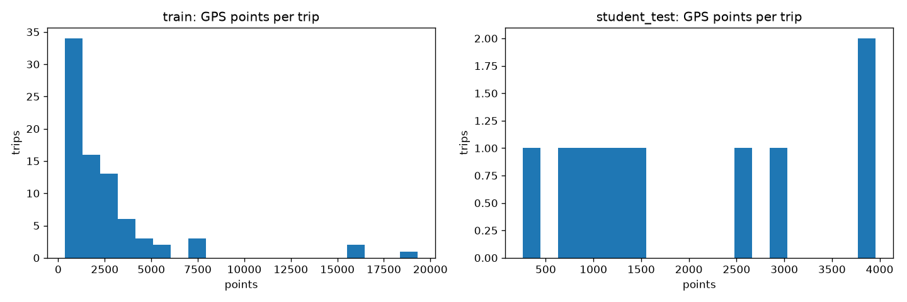

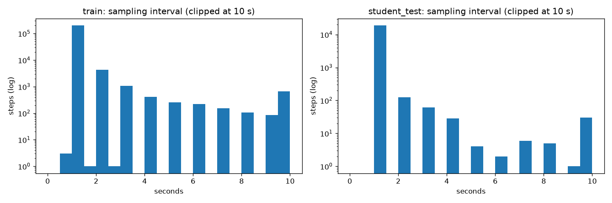

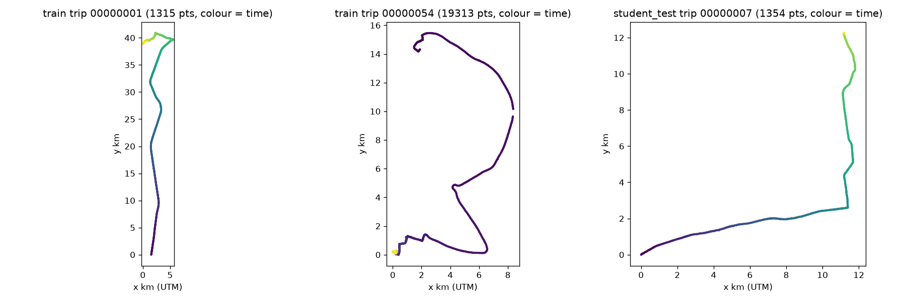

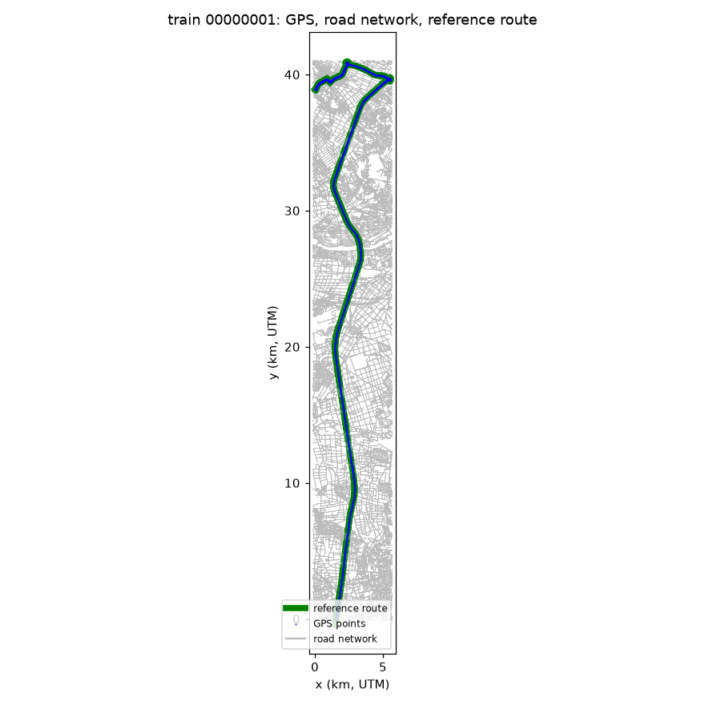

The interactive Folium maps `results/maps/train_00000001.html` and `results/maps/student_test_00000007.html` (code: `src/maps.py`) show GPS points, the nearby road network, the reference route and start/end markers with a legend and layer control.

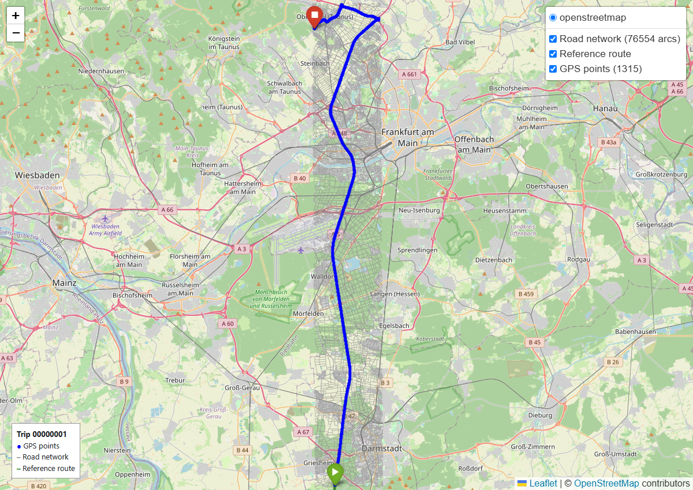

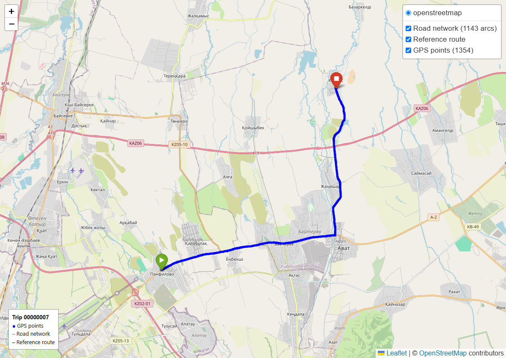

## 2.2.3 Features extracted and why

One row per (GPS point, candidate arc), built in `src/features.py`:

| Feature | Why |
|---|---|
| dist_m | Perpendicular distance to the arc; the true road is usually the closest. |
| distance_rank | Rank among this point's candidates; relative, so robust to noise level. |
| heading_diff_deg | Angle between GPS motion and arc bearing; separates the two directions of a road and parallel roads. |
| speed_mps | Speed from the previous point; heading is unreliable at low speed. |
| arc_length_m | Long arcs collect more nearby points (prior). |
| from_degree, to_degree | Node degree at the arc ends; marks junctions where confusion is likely. |
| candidate_count | Number of arcs within R; how ambiguous the point is. |
| distance_gap_m | Gap between nearest and second-nearest candidate; large means confident. Filled with R when there is one candidate. |
| offset_fraction | Where the point projects along the arc (0 to 1); 0 or 1 suggests a neighbouring arc. |

No feature uses the true previous arc (that would leak the label); connectivity is left to the HMM.

# 3. Model experimentation and comparison

All models are trained on the 80 train trips with 5-fold GroupKFold by trip, so no trip is split across folds. Each fit uses one fixed 100,000-row random subsample (seed 42) of the training fold, because KNN took over 10 minutes per run at 200,000 rows; validation and test use all rows. Scaling (StandardScaler) is used only for LogisticRegression and KNN, inside a Pipeline so it is fitted on training folds only. Threshold 0.5. Code: `training/train_models.py`; configuration: `results/train_config.json`.

**Primary selection metric:** mean CV macro F1 on train trips. The positive class (true arc) is only about 5% of candidate rows, so accuracy would be dominated by negatives; macro F1 weighs both classes equally. Observation-level Top-1 (for each GPS point, the highest-probability candidate compared with the label) is the metric closest to the task and is reported alongside; log loss measures probability quality, which matters because the probabilities feed the HMM.

## 3.1 Overall model comparison

| Model | Family | Key configuration | CV macro F1 (mean +/- std) | Test Top-1 | Continuity | Test macro F1 | Test log loss | Inference (s) |
|---|---|---|---|---|---|---|---|---|
| LogisticRegression | Linear | StandardScaler, L2, C=1, max_iter=1000 | 0.8308 +/- 0.0286 | 0.7977 | N/A: a single classifier gives no route; see section 5 | 0.8480 | 0.0773 | 0.07 |
| GaussianNB | Probabilistic | default (var_smoothing 1e-9) | 0.7682 +/- 0.0158 | 0.7341 | N/A: a single classifier gives no route; see section 5 | 0.7701 | 0.3137 | 0.27 |
| KNN | Instance-based | StandardScaler, k=25, uniform weights | 0.8229 +/- 0.0224 | 0.7461 | N/A: a single classifier gives no route; see section 5 | 0.8336 | 0.1387 | 84.92 |
| RandomForest | Bagging ensemble | 200 trees, min_samples_leaf=5 | 0.8749 +/- 0.0296 | 0.8044 | N/A: a single classifier gives no route; see section 5 | 0.8924 | 0.0730 | 0.68 |
| HistGradientBoosting | Boosting | defaults (lr 0.1, max_iter 100, 31 leaves, early stopping) | 0.8767 +/- 0.0289 | 0.8029 | N/A: a single classifier gives no route; see section 5 | 0.8901 | 0.0544 | 0.23 |

Note: "Test" means student_test; inference time is for all 389,287 student_test candidate rows. Route continuity is measured for the final model with and without the HMM in section 5 (classifier-only 0.8998, with HMM 0.9738). Training time (s) on the 100,000-row subsample: LogisticRegression 0.22, GaussianNB 0.06, KNN 0.19, RandomForest 4.25, HistGradientBoosting 0.29. Train-set scores on the same subsample (for over/underfitting, `results/model_train_scores.csv`):

| Model | train macro F1 | CV macro F1 | gap | train log loss | CV log loss |
|---|---|---|---|---|---|
| LogisticRegression | 0.8322 | 0.8308 | +0.0014 | 0.0929 | 0.0927 |
| GaussianNB | 0.7711 | 0.7682 | +0.0029 | 0.3159 | 0.3449 |
| KNN | 0.8383 | 0.8229 | +0.0154 | 0.0692 | 0.1606 |
| RandomForest | 0.9349 | 0.8749 | +0.0600 | 0.0365 | 0.0774 |
| HistGradientBoosting | 0.8983 | 0.8767 | +0.0217 | 0.0505 | 0.0666 |

**Selection.** HistGradientBoosting has the highest mean CV macro F1 (0.8767) and the lowest log loss on both CV (0.0666) and student_test (0.0544). RandomForest is 0.0023 higher on student_test macro F1 and 0.0015 higher on Top-1, far less than the fold standard deviation (~0.03), so the difference is not meaningful; HistGradientBoosting is also about 15 times faster to train and 3 times faster to predict. Its better-calibrated probabilities matter most because they are the HMM emission input.

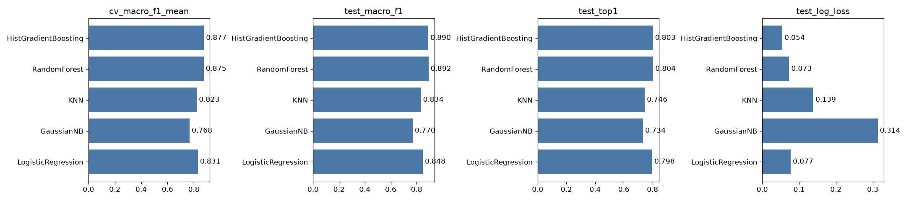

## 3.2 Questions for every model

### LogisticRegression

**A1. Why suitable?** The features are mostly monotone signals (closer, better-aligned arcs are more likely), which a linear model on scaled features can capture, and it gives probabilities directly. **A2. Strengths and limits.** Fast (0.07 s to score 389,287 student_test rows) and stable across folds (std 0.0286); but it cannot model interactions such as "heading matters only when speed is high", which limits it to CV macro F1 0.8308. **B5. Hyperparameters.** L2 penalty, C=1.0, lbfgs, max_iter=1000, StandardScaler. **B6. Objective.** Binary cross-entropy (log loss) with L2 regularisation. **C7/C8. student_test.** Macro F1 0.8480, Top-1 0.7977, log loss 0.0773. **C9. Over/underfitting.** Train macro F1 0.8322 vs CV 0.8308 (gap 0.0014): no overfitting, but the low ceiling compared with the tree models points to underfitting (high bias).

### GaussianNB

**A1. Why suitable?** A fast probabilistic baseline that turns per-feature class distributions into a posterior. **A2. Strengths and limits.** Trains in 0.06 s; but it assumes features are independent and Gaussian, while ours are strongly correlated (dist_m, distance_rank, distance_gap_m) and skewed. This gives the worst probabilities (CV log loss 0.3449) and the lowest CV macro F1 (0.7682). **B5. Hyperparameters.** Defaults (var_smoothing 1e-9); no scaling needed. **B6. Objective.** Maximum-likelihood estimation of class priors and per-feature Gaussian means and variances. **C7/C8. student_test.** Macro F1 0.7701, Top-1 0.7341, log loss 0.3137. **C9.** Train 0.7711 vs CV 0.7682 (gap 0.0029): no overfitting; it underfits because its independence assumption is wrong for these features.

### KNN

**A1. Why suitable?** Candidate rows with similar geometry (distance, heading difference, rank) should share labels, which is what a neighbourhood vote expresses. **A2. Strengths and limits.** No training cost (0.19 s), but prediction is slow: 84.92 s for student_test and 769 s for the whole CV run, the slowest by far. Its probabilities are coarse (multiples of 1/25), giving a high log loss (CV 0.1606). **B5. Hyperparameters.** k=25, uniform weights, Euclidean distance on standardised features. **B6. Objective.** None is optimised; prediction is a majority vote of the 25 nearest training rows. **C7/C8. student_test.** Macro F1 0.8336, Top-1 0.7461, log loss 0.1387. **C9.** Train 0.8383 vs CV 0.8229 (gap 0.0154), and train log loss 0.0692 vs CV 0.1606: mild overfitting in the probabilities, because each training row is among its own neighbours.

### RandomForest

**A1. Why suitable?** Trees capture non-linear rules and feature interactions (for example heading difference only matters when moving), and averaging 200 trees reduces variance. **A2. Strengths and limits.** Best student_test macro F1 (0.8924) and Top-1 (0.8044); but the largest train-CV gap and the slowest training of the tree models (4.25 s). **B5. Hyperparameters.** n_estimators=200, min_samples_leaf=5, max_features="sqrt", bootstrap on. **B6. Objective.** Each split minimises Gini impurity; trees are averaged. **C7/C8. student_test.** Macro F1 0.8924, Top-1 0.8044, log loss 0.0730. **C9.** Train macro F1 0.9349 vs CV 0.8749 (gap 0.0600) and train log loss 0.0365 vs CV 0.0774: clear overfitting to the training rows, although CV performance is still among the best.

### HistGradientBoosting (selected)

**A1. Why suitable?** Boosted trees correct the previous trees' errors on the hard candidates (junctions, parallel roads), handle unscaled features, and are fast on hundreds of thousands of rows. **A2. Strengths and limits.** Best CV macro F1 (0.8767) and best log loss (CV 0.0666, student_test 0.0544) with 0.29 s training; a limitation is many interacting hyperparameters (tuned in section 4). **B5. Hyperparameters.** learning_rate 0.1, max_iter 100, max_leaf_nodes 31, min_samples_leaf 20, l2_regularization 0, max_bins 255, early stopping on a 10% validation split (on automatically above 10,000 rows). **B6. Objective.** Binary cross-entropy (log loss), minimised by gradient boosting. **C7/C8. student_test.** Macro F1 0.8901, Top-1 0.8029, log loss 0.0544. **C9.** Train 0.8983 vs CV 0.8767 (gap 0.0217) and train log loss 0.0505 vs CV 0.0666: a small gap, so mild overfitting only.

## 3.3 Model visualisations

None of the five models produces epoch-wise training histories in our setup, so no loss curves are shown. Confusion matrices (left: CV out-of-fold on train; right: student_test; threshold 0.5):

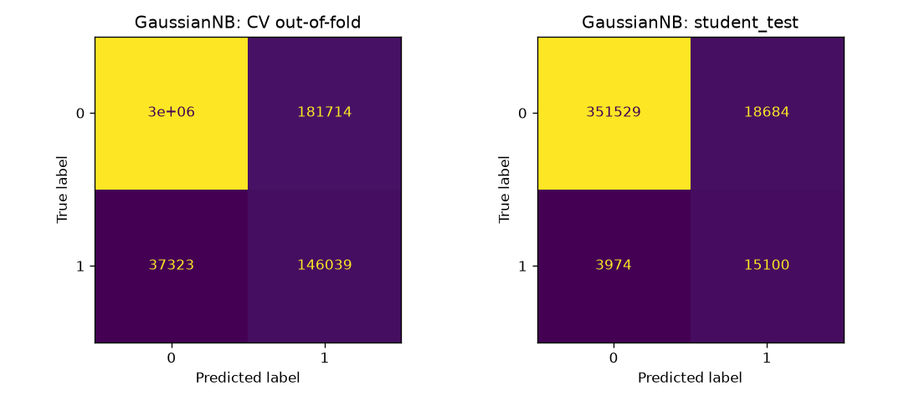

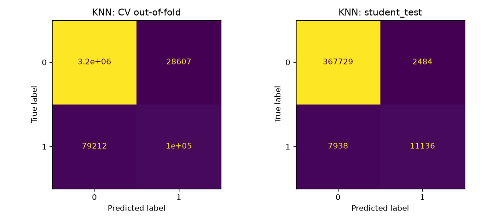

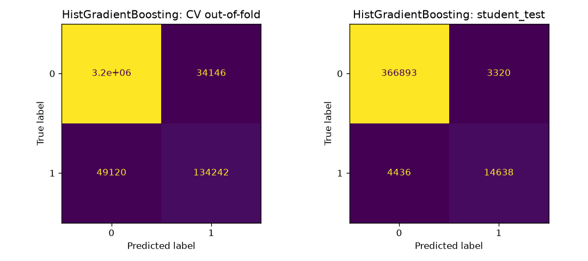

# 4. Bayesian hyperparameter optimisation (HistGradientBoosting)

Code: `training/bayes_opt.py`; configuration: `results/optuna_config.json`.

**1. Hyperparameters searched:** learning_rate, max_iter, max_leaf_nodes, min_samples_leaf, l2_regularization, max_bins.

**2. Ranges:** learning_rate 0.01 to 0.3 (log scale); max_iter 100 to 600; max_leaf_nodes 15 to 127; min_samples_leaf 10 to 200; l2_regularization 1e-6 to 10 (log scale); max_bins 64 to 255 (integers uniform).

**3. Objective:** mean 5-fold GroupKFold macro F1 (threshold 0.5) on the 80 train trips, with the same 100,000-row subsample per fold and the same ten features as section 3. student_test was not loaded during the search.

**4. Trials:** 50 trials, Optuna TPE sampler, seed 42. Total search time 20.4 minutes (mean 24.5 s per trial). Trial values ranged from 0.8694 to 0.8788 (std 0.0017).

**5. Best values (trial 39):** learning_rate 0.0207, max_iter 560, max_leaf_nodes 19, min_samples_leaf 30, l2_regularization 1.35e-5, max_bins 159. The best trials share a small number of leaves (17 to 20) with a low learning rate; the worst trial used 43 leaves with learning rate 0.27. fANOVA importance puts max_leaf_nodes first (about 0.58), then max_iter and learning_rate (about 0.13 each).

**6. Did tuning help?** Only marginally. Same data, partitions and metrics for both models (`results/tuned_vs_untuned.csv`):

| Metric | Untuned | Tuned |
|---|---|---|
| CV macro F1 (mean +/- std) | 0.8767 +/- 0.0289 | 0.8788 +/- 0.0295 |
| CV log loss | 0.0666 | 0.0652 |
| CV Top-1 | 0.7312 | 0.7325 |
| Train macro F1 / log loss | 0.8983 / 0.0505 | 0.8938 / 0.0542 |
| student_test macro F1 | 0.8901 | 0.8925 |
| student_test Top-1 | 0.8029 | 0.8046 |
| student_test log loss | 0.0544 | 0.0533 |
| student_test precision / recall | 0.8151 / 0.7674 | 0.8199 / 0.7719 |
| Training time (s) | 0.45 | 1.93 |
| Inference time (s, student_test) | 0.28 | 1.50 |

The CV gain is +0.0021, well inside the fold standard deviation of about 0.03, so we do not claim the tuned model is reliably better. It does have a smaller train-CV gap (0.0151 vs 0.0217) and slightly better log loss everywhere. We export the tuned model because it wins on the pre-declared criterion (mean CV macro F1 on train trips), and its 1.5 s inference for all 10 trips is acceptable for the API.

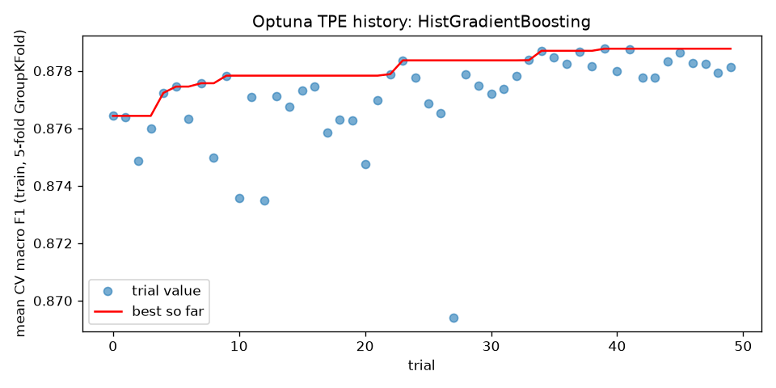

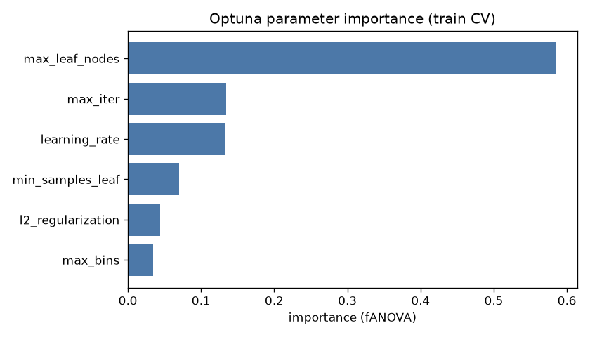

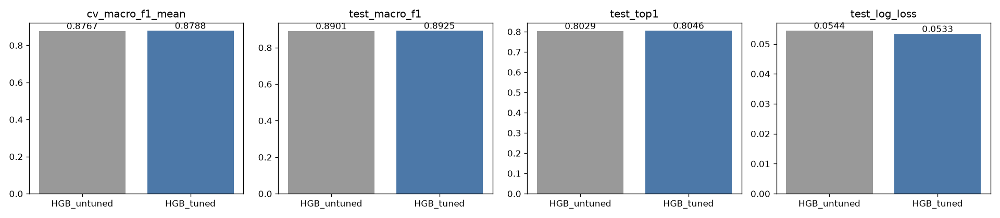

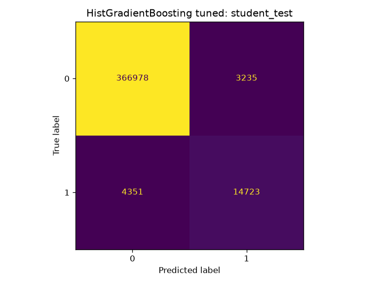

# 5. HMM and Viterbi route reconstruction

Code: `src/hmm.py` (decoder), `src/pipeline.py` (end-to-end), `training/tune_hmm.py` (tuning), `training/evaluate_hmm.py` (comparison).

**1. Hidden states.** For each GPS point, the hidden states are its candidate arcs (the same arcs as the classifier's candidate table, so every state maps back to one road segment). A point with no candidate within 80 m has no states.

**2. Emission probabilities.** Log-space blend of the tuned classifier probability and a Gaussian distance term: `log e = w * log(p_classifier) + (1 - w) * (-0.5 * (dist_m / sigma)^2)`, with w = 0.75 and sigma tuned (40 m).

**3. Transition probabilities.** `log a = -|road distance - GPS distance| / beta`. The road distance is the rest of the previous arc, plus the Dijkstra shortest path between the arcs on the directed road graph, plus the part of the next arc up to the point (from `offset_fraction`). Staying on the same arc uses the offset difference. Dijkstra is bounded at `min(3000 m, max(500 m, 4 x GPS distance + 100 m))` and cached per source node. Viterbi keeps the best log score per state with back-pointers, then backtracks.

**4. Missing candidates and large gaps.** A point with no candidates is skipped: the chain continues from the previous point that had candidates, and the skipped point gets arc -1 (counted as wrong in Top-1). If the time between two consecutive points with candidates exceeds the gap threshold (tuned: 30 s), the chain is split and a new Viterbi segment starts from emissions only, because the road distance over a long gap is unknowable.

**5. Disconnected road segments.** If the next arc cannot be reached within the search bound, the pair gets the penalty `-(search bound - GPS distance) / beta`, i.e. at least as bad as the worst reachable pair. We changed this from a fixed -20, which ignored beta: with a small beta it made an unreachable jump more likely than a reachable detour. Route reconstruction then joins consecutive decoded arcs with the shortest path when they are within the gap threshold and reachable, and merges repeats.

**Tuning (development, train only).** Grid sigma {15, 25, 40} m x beta {20, 50, 100} m x gap {5, 30, 60} s on the first 20 train trips, selected by mean observation-level Top-1. Best: sigma 40 m, beta 20 m, gap 30 s, train Top-1 0.8987; worst: 0.8690 (sigma 15, beta 100, gap 5). The classifier was fitted on train trips, so these train scores are optimistic. beta = 20 m is the lowest value in the grid, so a smaller beta may be better; we did not search further. Sigma has almost no effect (0.8986 to 0.8987 at beta 20, gap 30).

**6. Did the HMM improve the route?** Yes, on 9 of 10 student_test trips (final comparison; parameters fixed on train). Point metrics use the derived labels; macro F1 here is the multi-class F1 over arc ids per point, which is not the binary candidate macro F1 of section 3. Route precision and recall compare the reconstructed arc sequence with `.route`; continuity is the share of consecutive points (within the gap threshold) whose decoded arcs are equal or connected. Time is per trip, including candidate generation and scoring.

| student_test mean (10 trips) | Top-1 | macro F1 | route precision | route recall | continuity | time per trip (s) |
|---|---|---|---|---|---|---|
| Classifier only (argmax per point) | 0.8225 | 0.6670 | 0.2272 | 0.9892 | 0.8998 | 1.21 |
| Classifier + HMM | 0.8951 | 0.8694 | 0.8341 | 0.9877 | 0.9738 | 5.58 |

| Trip | Top-1 classifier | Top-1 HMM | route precision classifier | route precision HMM | continuity classifier | continuity HMM |
|---|---|---|---|---|---|---|
| 00000000 | 0.9281 | 0.9620 | 0.2464 | 0.7936 | 0.9536 | 0.9948 |
| 00000007 | 0.9077 | 0.8634 | 0.4291 | 0.9758 | 0.9941 | 1.0000 |
| 00000009 | 0.8093 | 0.8866 | 0.4163 | 0.8737 | 0.8531 | 0.9399 |
| 00000040 | 0.8748 | 0.9292 | 0.1713 | 0.8218 | 0.9472 | 0.9923 |
| 00000052 | 0.9313 | 0.9847 | 0.2123 | 1.0000 | 0.9272 | 0.9655 |
| 00000056 | 0.8585 | 0.9568 | 0.1974 | 0.9339 | 0.8658 | 0.9636 |
| 00000065 | 0.7161 | 0.7799 | 0.1501 | 0.8480 | 0.8851 | 0.9791 |
| 00000076 | 0.7921 | 0.9112 | 0.2003 | 0.7300 | 0.8336 | 0.9508 |
| 00000077 | 0.5917 | 0.7461 | 0.0968 | 0.4444 | 0.8854 | 0.9821 |
| 00000091 | 0.8158 | 0.9314 | 0.1522 | 0.9203 | 0.8534 | 0.9702 |

Top-1 rises from 0.8225 to 0.8951 and continuity from 0.8998 to 0.9738. The largest effect is on route precision (0.2272 to 0.8341): classifier-only jumps between nearby arcs from point to point, and joining every jump with a shortest path adds many arcs that are not on the route. Recall is already high for both. The cost is about 4.4 s more per trip.

**Where the HMM did not help (`results/hmm_failures.csv`).** Trip 00000007: Top-1 falls from 0.9077 to 0.8634. In all 77 points where the HMM is wrong and the classifier right, the HMM picked the reverse-direction twin of the true arc, in 61 runs of one or two points, at a median speed of 7.53 m/s against 18.15 m/s over the whole trip. Our transition model does not penalise a U-turn onto the twin arc, and at low speed the heading feature is unreliable. Even on this trip the HMM route has higher precision (0.9758 vs 0.4291). Trip 00000077 improves the most (+0.1544 Top-1) but remains the weakest trip (Top-1 0.7461, route precision 0.4444).

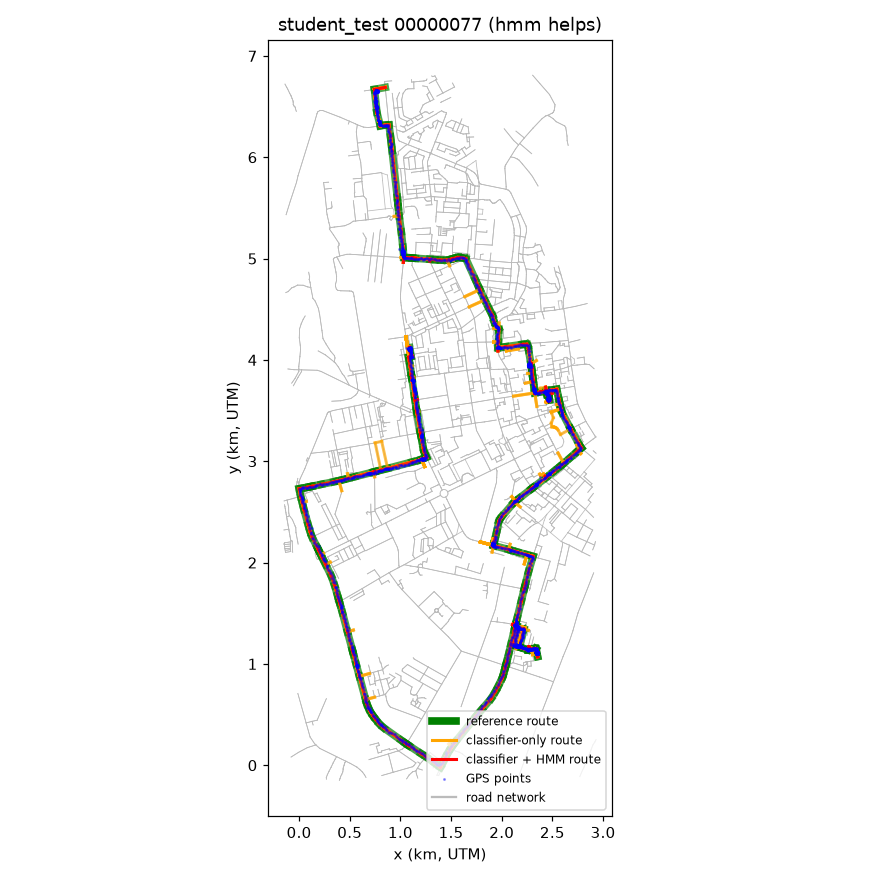

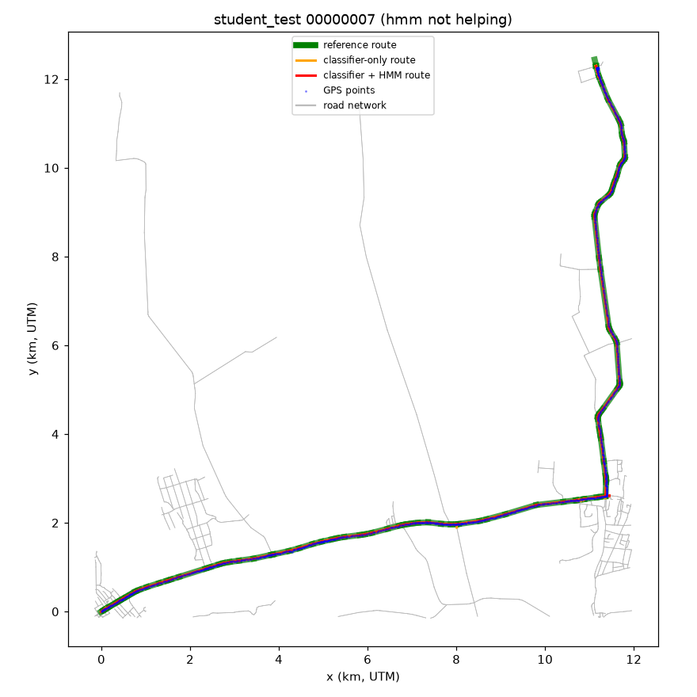

# 6. Geographical visualisation using Folium

Map code: `src/maps.py`, function `make_map(trip, predicted_arcs=None, out_path=None, classifier_arcs=None, predicted_name=...)`. Each map is fitted to the track's bounding box and has separate layers with a layer control: GPS points (blue circles, timestamp tooltip), nearby road network (thin grey lines; arcs inside the track bounding box plus 150 m), reference route (green), classifier-only route (orange), predicted or HMM route (red), start and end markers, and a legend. Folium takes (lat, lon), so coordinates are swapped from the stored (lon, lat).

| Map file | Partition | Layers |
|---|---|---|
| results/maps/train_00000001.html | train | GPS, network, reference |
| results/maps/student_test_00000007.html | student_test | GPS, network, reference |
| results/maps/student_test_00000077_hmm_helps.html | student_test | GPS, network, reference, classifier-only, classifier + HMM |
| results/maps/student_test_00000007_hmm_not_helping.html | student_test | GPS, network, reference, classifier-only, classifier + HMM |

The figures in sections 2.2 and 5 are static prints of the same layers, drawn by `report/make_figures.py`; the HTML files are the interactive versions.

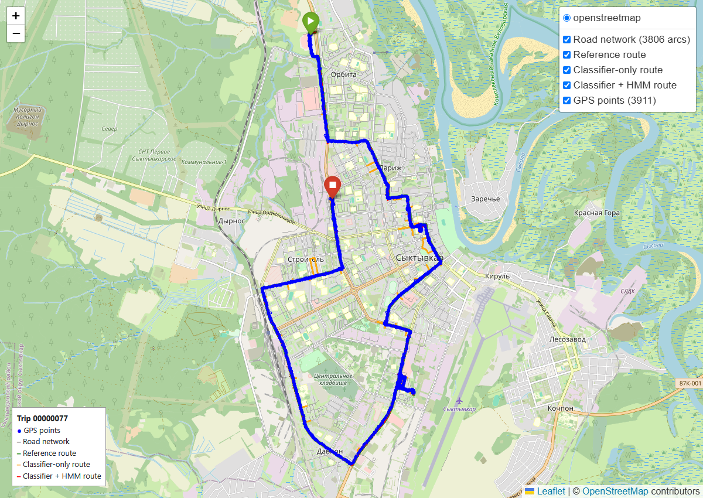

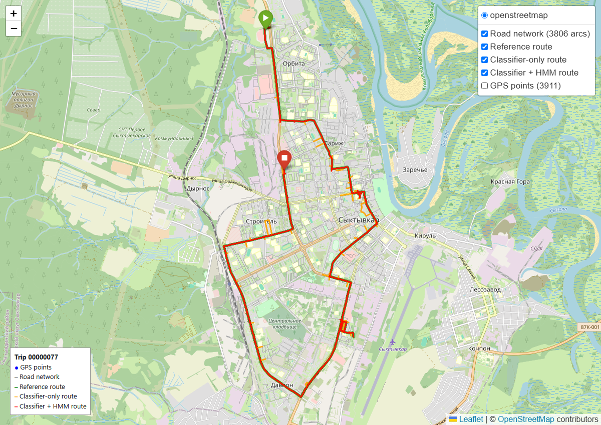

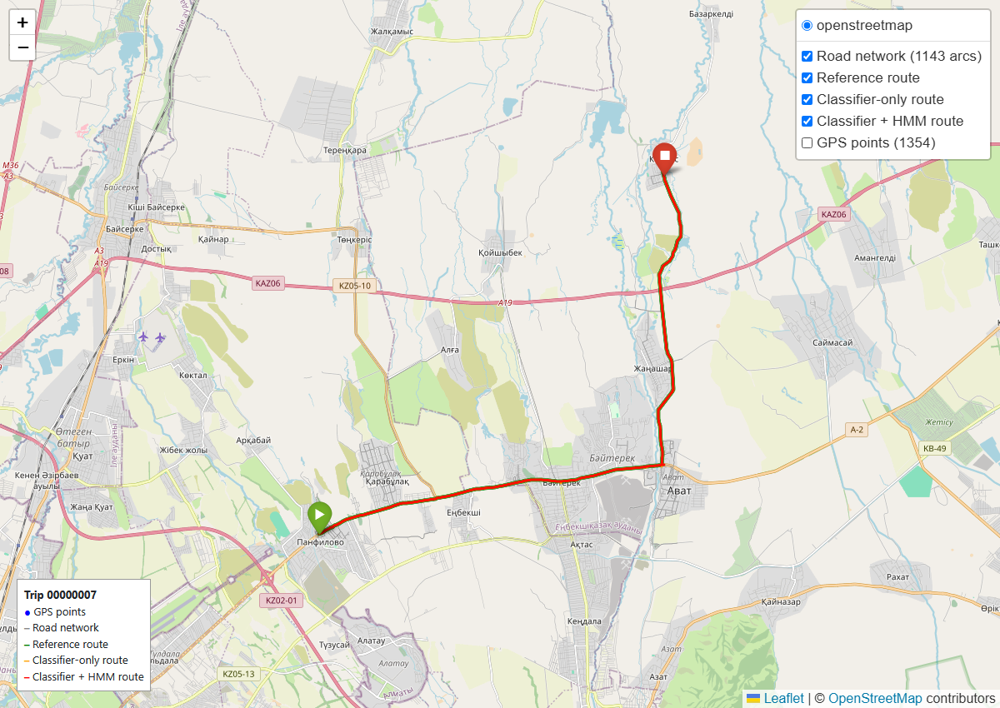

# 7. API, UI and deployment

**API** (`api/main.py`, FastAPI, started with `uvicorn api.main:app --host 0.0.0.0 --port 8000`). The model, feature list and HMM parameters are loaded once at startup (one "Loaded model artifact" line in the console log for the whole run). Endpoints: `GET /health`, `GET /trips` (trip ids from `EVAL_DIR`, default `data/student_test`), and `POST /predict {trip_id}`, which runs load, clean, candidates, classifier, Viterbi, route reconstruction and metrics. The reference route is read only on the server, to compute metrics. Response keys: `trip_id, gps, predicted_route, per_obs_arcs, metrics, predictor`; metric keys: `top1_acc, macro_f1, route_precision, route_recall, continuity, n_obs, time_ms`. Every request is logged ("Prediction requested" and "Prediction complete" with client address and time). CORS allows any origin by default (`CORS_ORIGINS`).

**Checks we ran** (`tests/api_smoke.py`; results in `results/api_timing.csv` and `results/api_console_log.txt`): all 10 student_test trips returned exactly the contract keys; no response contains the reference route or labels; per-trip Top-1 from the API equals the offline evaluation; a CORS preflight from another origin is allowed; with `EVAL_DIR=data/train` the API listed 80 trips instead of 10; 10 requests produced 10 "requested" and 10 "complete" log lines. A grep of `api/` and `ui/` for trip ids and coordinate arrays found no hardcoded trips or routes (only the map's initial view centre in `ui/app.js`).

**UI** (`ui/`, plain HTML, JavaScript and Leaflet, served with `python -m http.server 5500 --directory ui`). It takes the API base URL, loads the trip list from `/trips`, posts the chosen trip and draws the GPS points (blue) and the predicted route (green), with a metrics panel and the list of predicted arc ids. It uses only `gps`, `predicted_route`, `per_obs_arcs`, `metrics` and `predictor` from the response, so it never receives or draws the reference route.

**Timing** (API and test client on one laptop, `results/api_timing.csv`; request 1 is the first request after startup):

| Request | Trip | Points | Wall time (s) | Top-1 | Route precision | Route recall | Continuity |
|---|---|---|---|---|---|---|---|
| 1 | 00000000 | 2,503 | 4.98 | 0.9620 | 0.7936 | 0.9665 | 0.9948 |
| 2 | 00000007 | 1,354 | 1.42 | 0.8634 | 0.9758 | 0.9837 | 1.0000 |
| 3 | 00000009 | 1,049 | 7.52 | 0.8866 | 0.8737 | 0.9837 | 0.9399 |
| 4 | 00000040 | 2,995 | 3.93 | 0.9292 | 0.8218 | 1.0000 | 0.9923 |
| 5 | 00000052 | 262 | 0.61 | 0.9847 | 1.0000 | 0.9789 | 0.9655 |
| 6 | 00000056 | 3,958 | 12.97 | 0.9568 | 0.9339 | 0.9924 | 0.9636 |
| 7 | 00000065 | 768 | 2.93 | 0.7799 | 0.8480 | 1.0000 | 0.9791 |
| 8 | 00000076 | 1,486 | 10.47 | 0.9112 | 0.7300 | 0.9759 | 0.9508 |
| 9 | 00000077 | 3,911 | 11.02 | 0.7461 | 0.4444 | 1.0000 | 0.9821 |
| 10 | 00000091 | 874 | 4.42 | 0.9314 | 0.9203 | 0.9957 | 0.9702 |

Time depends more on candidates per point than on the number of points: 00000009 has 1,049 points but 35.8 candidates per point and takes 7.5 s. The first request was not unusually slow (4.98 s for 2,503 points), because the model loads at startup and the Dijkstra cache is built per request.

**Two-laptop test.** We ran the API on Laptop 1 (`10.92.245.19:8000`) and the UI on Laptop 2 (`10.92.245.96`, served on port 5500) over the same network. Laptop 2 loaded the trip list and requested trips 00000000 and 00000040. The API console on Laptop 1 logged both requests with the client address: trip 00000000 (2,503 points) finished in 3,526.66 ms with Top-1 96.2%, and trip 00000040 (2,995 points) in 3,492.78 ms with Top-1 92.9%, the same accuracies as our offline evaluation.

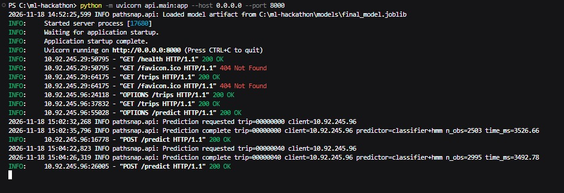

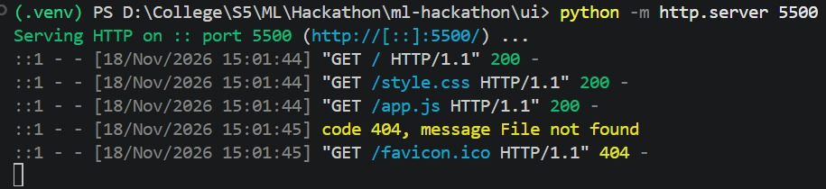

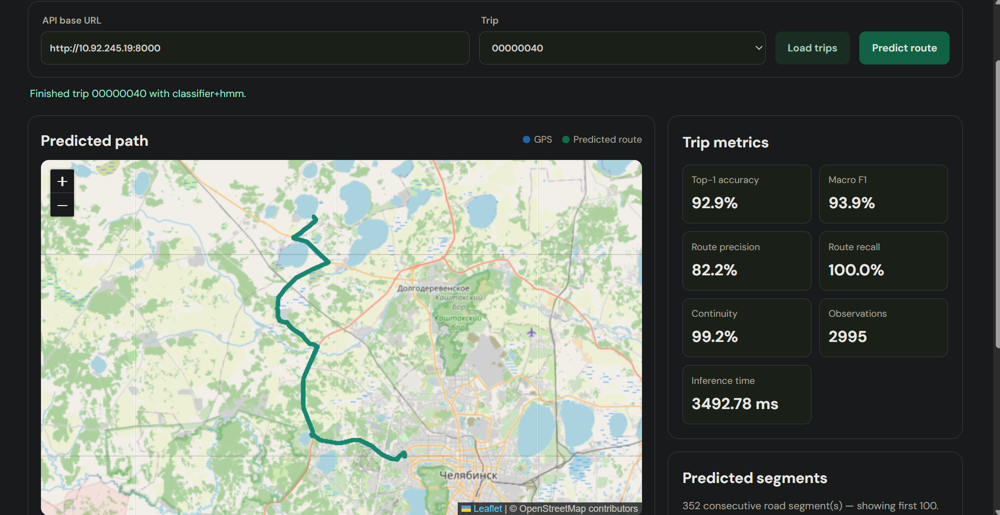

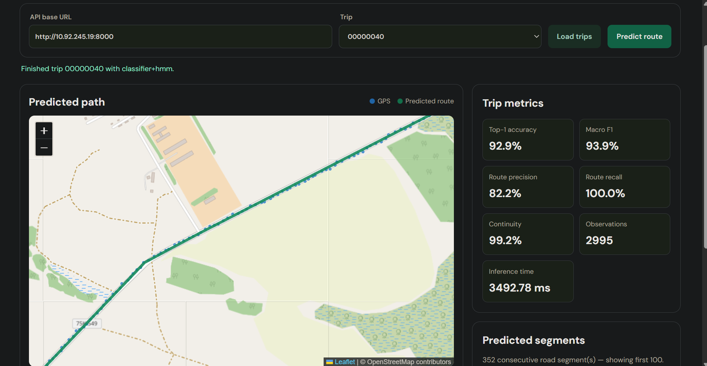

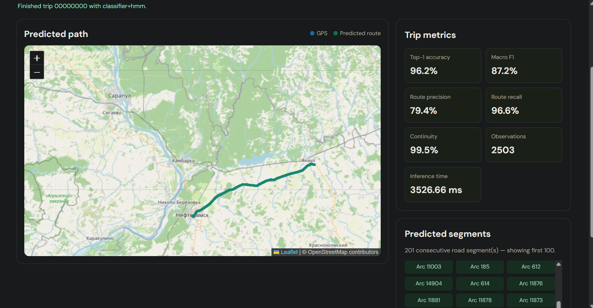

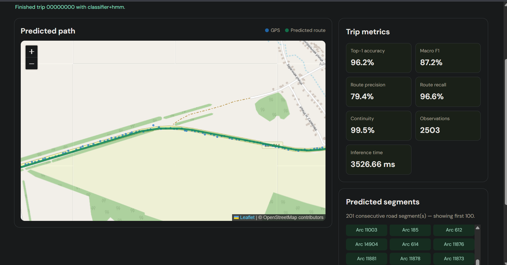

**Run on the evaluation set.** We then pointed the API at the evaluator trips (`EVAL_DIR`) and ran the same pipeline from the UI on Laptop 2, with no change to the model or HMM parameters. These trips were not used for training, tuning or any choice in this report; the results below are reported only, as shown by the UI:

| Evaluator trip | Points | Top-1 | Macro F1 | Route precision | Route recall | Continuity | Time (ms) |
|---|---|---|---|---|---|---|---|
| 00000015 | 6,854 | 84.0% | 42.5% | 19.7% | 99.3% | 98.7% | 11,297.9 |
| 00000049 | 2,642 | 99.8% | 99.1% | 99.0% | 99.8% | 99.4% | 4,782.61 |

Trip 00000049 is matched almost perfectly. Trip 00000015 keeps a good Top-1 (84.0%) and recall (99.3%) but low route precision (19.7%) and macro F1 (42.5%): the route loops through a dense network of small paths, and the reconstructed route contains many arcs that are not on the reference, similar to our weakest student_test trip (00000077).

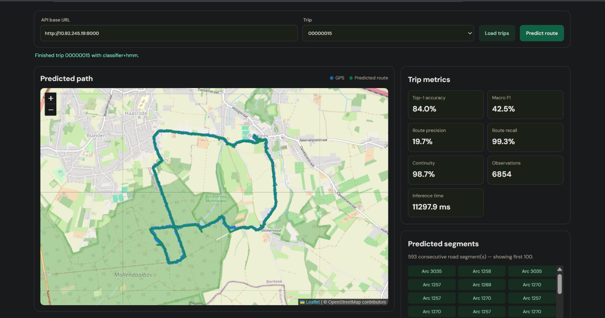

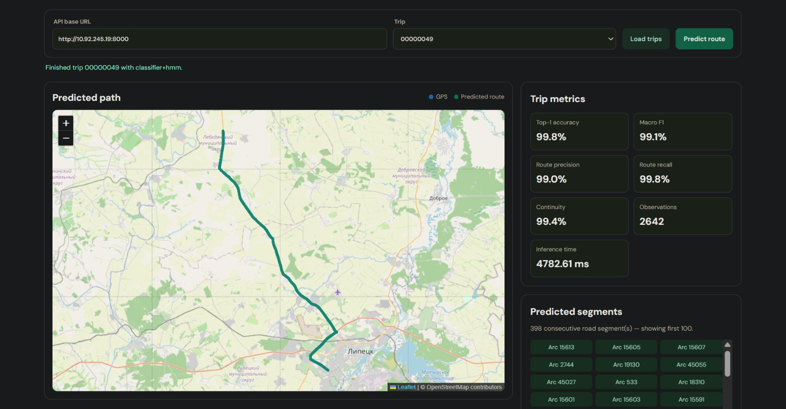

# Limitations

- Candidate miss rate on train is 0.1202 at R = 80 m, mostly from trip 00000054 (0.885 of its 19,313 points) and trips 00000093 (0.640) and 00000033 (0.513), where the GPS lies far from the reference route. These trips stay in training, with all their candidate rows labelled 0. On student_test the miss rate is 0.0045.
- Labels are derived, not given: label mismatch rate 0.0856 (train) and 0.0903 (student_test). Every metric inherits this uncertainty.
- Speed and heading over time gaps: `src/features.py` computes speed as displacement divided by the time step and heading from the previous point, regardless of the step. After a long gap (up to 153,064 s) speed is near 0 and heading is meaningless; the first point of each trip gets speed 0 and heading 0 degrees. We did not fix this.
- 100,000-row fit subsample: every classifier fit uses a fixed 100,000-row subsample of the 3,383,391 train candidate rows, for speed.
- student_test reuse: student_test was used for the five-model comparison, the tuned vs untuned comparison and the HMM comparison, so its numbers are development results and optimistic as an estimate of evaluator performance. HMM parameters were tuned on train only (first 20 trips) with a classifier fitted on train trips, and beta was at the edge of its grid.
- U-turns: the HMM does not penalise switching to the reverse twin arc, which caused the only HMM failure (trip 00000007).

# AI assistance

We used an AI coding assistant (Claude Code) while writing and debugging parts of the code and while drafting this report. All experiments were run with the code in this repository, the numbers are taken from the result files listed below, and each of us has gone through the code and results and can explain them.

# Sources of tables and figures

| Report item | Source file |
|---|---|
| 2.2 cleaning, inventory and pattern tables | results/preprocessing.json, results/eda/inventory.csv, results/eda/missing_invalid.csv, results/eda/timestamps.csv, results/eda/network.csv, results/eda/route_structure.csv, results/eda/per_trip_stats.csv |
| 2.2 label mismatch and candidate miss rate | results/preprocessing.json, results/candidate_miss_rate.csv, results/candidate_miss_rate_per_train_trip.csv, results/round1_preprocessing_summary.md |
| 2.2 figures | results/eda/points_per_trip_hist.png, results/eda/sampling_interval_hist.png, results/eda/trajectories_3_trips.png, report/figures/network_train_00000001.png |
| 3.1 comparison table | results/model_comparison.csv, results/train_config.json |
| 3.1 train vs CV table | results/model_train_scores.csv, results/model_comparison.csv |
| 3 figures | results/model_comparison.png, results/confusion_*.png |
| 4 answers and table | results/optuna_config.json, results/optuna_best.json, results/optuna_trials.csv, results/tuned_vs_untuned.csv |
| 4 figures | results/optuna_history.png, results/optuna_param_importance.png, results/tuned_vs_untuned.png, results/confusion_HistGradientBoosting_tuned.png |
| 5 tuning numbers | results/hmm_tuning.csv, models/hmm_params.json |
| 5 comparison tables | results/hmm_comparison.csv |
| 5 failure case | results/hmm_failures.csv, results/evaluate_hmm_log.txt |
| 5 figures | report/figures/student_test_00000077_hmm_helps.png, report/figures/student_test_00000007_hmm_not_helping.png |
| 6 maps | results/maps/*.html (code: src/maps.py) |
| 2.2 and 6 Folium screenshots | report/figures/folium_*.png (from results/maps/*.html by report/screenshot_maps.py) |
| 7 timing table and checks | results/api_timing.csv, results/api_console_log.txt |
| 7 screenshots | report/screenshots/ (taken during the two-laptop test) |
| 7 evaluation-set results | report/screenshots/eval_ui_trip15.png, report/screenshots/eval_ui_trip49.png (values read from the UI) |
